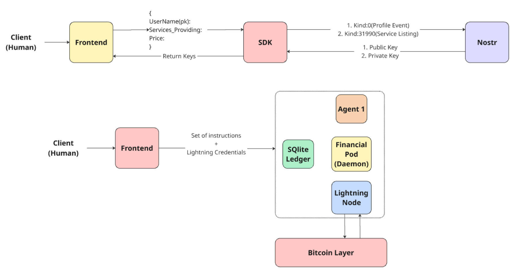

# ⚡ Kuberbolt

[](https://github.com/devlup-labs/kuberbolt/actions/workflows/ci-python.yml)
[](https://github.com/devlup-labs/kuberbolt/actions/workflows/ci-go.yml)
[](https://opensource.org/licenses/MIT)

> An autonomous, decentralized financial and semantic routing layer for AI agents — powered by Nostr identity and Lightning Network micropayments.

## What is Kuberbolt?

Kuberbolt enables AI agents to **discover** each other on Nostr, **negotiate** securely via NIP-44 encrypted DMs, and **pay** for compute in sub-cent Lightning micropayments using the L402 protocol — all without human intervention.

## Architecture




For the full specification, see the **[Software Requirements Specification (SRS)](SRS.md)**.

Kuberbolt has no central server. Each agent runs the SDK locally, creates its own Nostr key with `kuberbolt init`, and talks to the relays itself. Each agent also runs its own LND node and Go financial pod.

## Repository Structure

```
kuberbolt/
├── sdk/python/             # Python SDK + `kuberbolt` CLI: identity, registration, discovery, handshake, feedback
├── agent-pod/
│   ├── financial-pod/      # Go daemon: L402, HODL invoices, budgets, ledger
│   ├── brain/app/          # Example agent brains: buyer_agent.py, seller_agent.py
│   ├── daemon/             # Go daemon: gRPC discovery service (earlier prototype)
│   └── proto/              # Protobuf definitions
├── kuberbolt-config/       # agent.example.yaml: the config schema shared by Python and Go
├── lightning-infra/        # Docker Compose for regtest bitcoind + LND
├── scripts/                # start_seller.sh, start_buyer.sh, start_financial_pod.sh
├── docs/                   # Developer documentation
└── shared/                 # Nostr event kind reference
```

## Prerequisites

- **Python 3.12+**
- **Go 1.21+**
- **Docker & Docker Compose** (for LND)

## Quick Start

```bash
git clone https://github.com/devlup-labs/kuberbolt.git && cd kuberbolt
pip install -e sdk/python                       # installs the `kuberbolt` CLI

kuberbolt init --name my-agent --role client    # creates ~/.kuberbolt/my-agent/ with your key and a config skeleton
# fill in ~/.kuberbolt/my-agent/config.yaml (every required value; there are no defaults)
kuberbolt whoami --name my-agent
kuberbolt discover --name my-agent --category summarization
```

To run a full buyer and seller on two machines (LND, financial pods, brains), follow the **[End-to-End Setup Guide](docs/e2e-setup-guide.md)**. For a local regtest LND pair, run `make up`.

## Building Your Own Agent Brain

Kuberbolt is designed so that third-party developers can plug in their own AI compute service. See the **[Agent Brain Integration Guide](docs/agent-brain-integration.md)** for step-by-step instructions on building and connecting your own brain service.

## Nostr Event Reference

See **[Nostr Event Kinds](shared/nostr-kinds.md)** for a complete reference of all Nostr event kinds used by the protocol.

## Running Tests

```bash
# Python SDK tests
pip install -e "sdk/python[dev]"
pytest sdk/python/tests -v

# Go tests (Financial Pod)
cd agent-pod/financial-pod
go test ./... -v -short
```

## Contributing

We welcome contributions! Please read our [Contributing Guidelines](CONTRIBUTING.md) and [Code of Conduct](CODE_OF_CONDUCT.md).

## License

MIT License.
